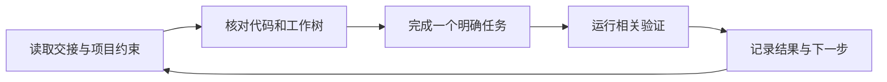

# vibe-coding-workflow

让下一次 AI 编程会话知道：项目做到哪里、哪些约束不能破坏、接下来怎样验证。

这是一套面向个人开发者的 Markdown 模板和协作流程。围绕 Claude Code 的使用经验整理，核心接续文档也可以用于其他编程工具。无需先搭建多 Agent 系统；从一份交接文档开始即可。

本仓维护可迁移的精简版。作者本机的详尽执行流程维护在 `real-vibecoding-harries` 元仓，包含实际路径、任务证据和发布恢复要求。复用者在自己的规则入口中指定适用流程。

[快速开始](#快速开始) · [新手教程](TUTORIAL.md) · [协作模板](templates/) · [更新记录](CHANGELOG.md)

## 一次接续怎样发生



例如，昨天停在登录表单的错误提示，今天换一个会话继续：交接文档记录修改文件、已通过的检查和仍未验证的流程，新会话先核对这些证据，再继续工作。它帮助减少重复解释，不能保证模型永不遗漏上下文。

## 快速开始

1. 将 [HANDOFF 模板](templates/HANDOFF.md) 复制到项目中，填写当前目标、状态和下一步。如果已有接续文档，直接更新原文件。
2. 根据需要参考 [项目约定模板](templates/CLAUDE.md)，把项目的构建命令和约束放进所用工具实际读取的规则文件。保留已有规则，不直接覆盖。
3. 在下一次会话发送：

```text
请在当前项目继续工作。先读取项目规则和 HANDOFF.md，
核对分支、未提交修改和当前实现，再完成交接中的下一项。
保留已有修改；执行相关验证后，更新接续记录。
已有授权直接推进，缺少必要信息时再提问。
```

最小交接记录可以只有这些内容：

```markdown
# 当前交接
- 目标：完善登录失败后的提示。
- 已完成：统一错误提示组件；修改 src/login.ts。
- 验证：npm test -- login 已通过；浏览器流程尚未验证。
- 下一步：检查错误凭据、网络超时和重试。
- 工作树：src/login.ts 尚未提交；勿混入其他任务修改。
```

想让助手协助接入，可从 [BOOTSTRAP.md](BOOTSTRAP.md) 开始。它先检查现有文件，只补当前任务所需的内容。

## 按需要增加，而非一次装齐

| 你的情况 | 建议使用 | 是否必需 |
|---|---|---|
| 一个项目，需要跨会话继续 | [HANDOFF.md](templates/HANDOFF.md) + 项目约定 | 最小起点 |
| 多个项目，需要查找状态 | [MEMORY.md](templates/MEMORY.md) 索引 | 可选 |
| 模块较多，交接变长 | [项目档案](sops/07-project-archive-five-piece.md) | 可选 |
| 独立任务适合并行处理 | [多 Agent 协作](sops/04-multi-agent-collaboration.md) | 可选，按任务授权使用 |
| 某些操作反复遗漏检查 | [PowerShell hooks](sops/09-hook-guards.md) | 可选，Windows 提醒脚本 |
| 希望整理跨项目经验 | [经验回送](sops/08-experience-repo-and-writeback.md)和[迭代协议](self-iteration/protocol.md) | 可选 |
| 需要验证 AI 变更并准备发布 | [审查与发布](sops/10-review-and-release.md)、[审查模板](templates/REVIEW.md)和[PR 模板](.github/pull_request_template.md) | 按风险接入 |
| 希望采用论文或前沿工程实践 | [研究资料转工作流](sops/11-research-to-workflow.md) | 记录来源、试用与撤销方法 |

## Hooks 能做什么

仓库提供 4 个 PowerShell 脚本，用于提醒批量暂存、提交信息、脚本编码和收尾反思。**当前均为 advisory：输出提醒，不阻断操作，也不保证规则被执行。** 启用前请检查当前工具的 hook 配置和事件格式，并按 [安装说明](sops/09-hook-guards.md) 验证触发结果。

阅读、复制 Markdown 不需要运行时；使用 Git 管理变更需要 Git；运行可选 hooks 需要 Windows PowerShell 和支持相应事件的工具。

## 文档导航

| 目的 | 入口 |
|---|---|
| 第一次接触 AI 协作 | [TUTORIAL.md](TUTORIAL.md) |
| 接入新项目或继续旧项目 | [会话开场 SOP](sops/03-new-session-onboarding.md) |
| 了解整体结构 | [架构总览](docs/01-架构总览.md) |
| 了解记忆与接续 | [长链记忆](docs/02-长链记忆体系.md) |
| 查找操作流程 | [SOP 索引](sops/README.md) |
| 参考历史实践 | [案例记录](docs/05-实践案例.md) |
| 查阅工程约束 | [AI-CONSTRAINTS.md](AI-CONSTRAINTS.md) |

案例和早期 SOP 记录了作者当时的工具与习惯，不能视为对所有平台的实测保证。采用时以当前项目规则、现有授权及实际工具能力为准，不必机械套用固定会话时长或上下文阈值。

## 贡献与许可证

欢迎提交问题或改进建议。修改流程时请描述具体场景、现有问题和验证方法；示例中不要包含凭据或私人项目数据。

[MIT License](LICENSE) · Copyright (c) 2026 Harly
